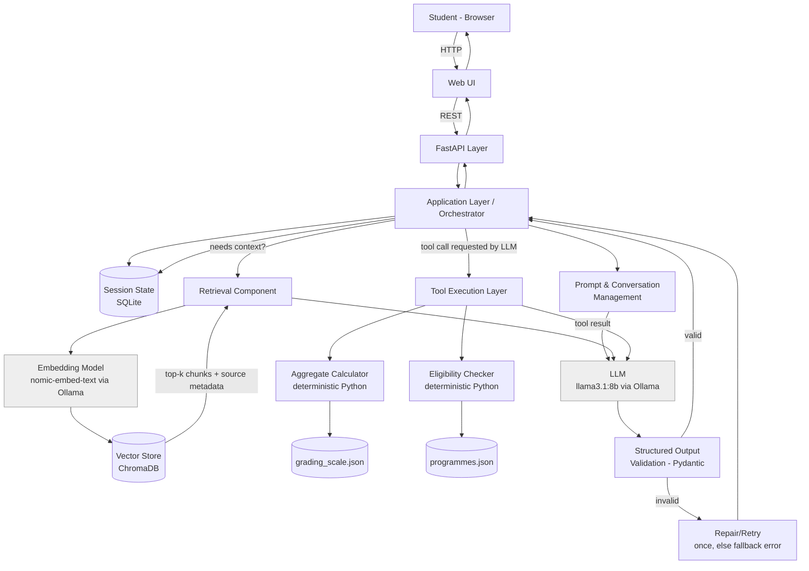

# PathwayGH Advisor — System Architecture

## Diagram

## Component Walkthrough (request trace)

1. **User → Web UI → FastAPI layer.** Student sends a message (e.g. grades + interests)
   through a simple web form. FastAPI exposes `/chat`, `/session/new`, and
   `/session/reset`.
2. **Application layer (orchestrator).** The only component that talks to every
   other component. It loads/creates session state, appends the new message to
   conversation history, and decides the sequence of LLM calls, tool calls, and
   retrieval calls needed to answer.
3. **Prompt & conversation management.** Builds the message list (system +
   history + new user turn) sent to the LLM. The system prompt is
   domain-specific and explicitly instructs the model: never invent a cutoff
   number, always prefer the calculator/eligibility tools for anything
   computable, and cite source documents when making a factual claim.
4. **LLM (local, via Ollama).** Handles language understanding and decides —
   using tool-calling — whether it needs a deterministic calculation, a
   programme-eligibility check, or retrieved context before it can answer
   usefully.
5. **Retrieval component.** On a retrieval-worthy query (e.g. "what electives
   does Business need?"), the orchestrator embeds the query, queries ChromaDB
   for the top-k chunks of `wassce_grading_and_admission_guide.md`, and returns
   each chunk with its source URL metadata attached. This metadata is what lets
   the final answer cite its source rather than assert a fact in a vacuum.
6. **Tool execution layer.** Two deterministic Python tools, triggered by the
   LLM's tool-call decision, not by LLM arithmetic:
   - **Aggregate Calculator** — takes six subject grades, looks up points in
     `grading_scale.json`, sums them, and checks the mandatory credit gate.
   - **Eligibility Checker** — takes a computed aggregate + track, looks up
     matching rows in `programmes.json`, and returns which programme
     categories the student plausibly qualifies for.
   Both tools return structured results; neither is allowed to be
   LLM-approximated.
7. **Structured output validation.** The LLM's final recommendation is forced
   into a Pydantic schema (`programme`, `fit_reason`, `confidence`,
   `caveats`, `sources`). A failed validation triggers one repair attempt
   (re-prompt with the validation error); a second failure returns a
   deterministic fallback message rather than a malformed or hallucinated
   response.
8. **Session state (SQLite).** Conversation history and any partially-collected
   student profile (grades entered so far) persist here, keyed by session ID.
   This is the only place "memory" lives — the LLM itself is stateless between
   calls; every call receives the full relevant history explicitly.

## Where Application State and Memory Reside

- **Conversation memory**: SQLite table, keyed by session ID. Not inside the
  LLM, not inside the vector store.
- **Domain knowledge**: static JSON (`grading_scale.json`, `programmes.json`)
  for facts that must be exact, and the vector store for facts that need
  retrieval-with-citation.
- **No implicit state**: every LLM call is given the orchestrator-assembled
  context explicitly; nothing is "remembered" by the model itself.

## Error-Handling Boundaries

Each external-facing call (LLM call, retrieval call, tool call) is wrapped
independently so one failure doesn't take down the whole turn:
- **LLM unavailable / Ollama down** → orchestrator returns a clear
  "advisor temporarily unavailable" message, not a silent hang.
- **Retrieval failure / empty vector store result** → the system says it
  couldn't find supporting information, rather than letting the LLM answer
  from unguided pretraining knowledge on a factual question.
- **Tool failure** (bad input grade format, etc.) → caught before reaching the
  LLM, returned as a validation error to the user asking them to correct input.
- **Malformed structured output** → one repair retry, then deterministic
  fallback (see above).

## Justification of Key Decisions

- **Local model via Ollama, not a hosted API**: no student data (grades,
  stated interests) leaves the machine/server it runs on, which matters for a
  system handling minors' academic data, and avoids per-request API cost for a
  course assignment with a real evaluation workload.
- **Model choice history — `qwen2.5:1.5b` initially, switched to
  `llama3.1:8b`**: the build started on `qwen2.5:1.5b` over `llama3.2:1b`,
  reasoning that Qwen2.5-Instruct models are tuned for structured-output
  reliability at small scale, and accepting as a deliberate trade-off that a
  1.5B model would produce malformed structured output more often than a
  larger model. That trade-off was treated as a real case to evaluate, not
  hidden — and live testing confirmed it, surfacing three distinct failure
  modes documented in detail in `docs/evaluation.md`: the model misreporting
  a real tool's result as fabricated category names (Failure 3), getting
  stuck re-asking for information it already had instead of acting on it
  (Failure 4), and — the most serious — writing fake tool-call-shaped JSON
  directly into its reply instead of triggering Ollama's real tool-calling
  mechanism at all (Failure 5). Based on that evidence, the default model
  was switched to `llama3.1:8b`, which has Ollama's most mature,
  officially-templated native tool-calling support of any locally-runnable
  model considered. This is expected to substantially reduce Failures 3 and
  5 specifically, though it has not been re-verified against live Ollama
  from the environment this project was built in (see evaluation.md's
  "what this does and doesn't fix" note on Failure 5) - the person running
  this should re-run `scripts/run_eval.py`'s manual cases after switching
  models and record what actually changes, rather than assuming the switch
  alone is sufficient. The validation/repair path and the fake-tool-call
  extractor in `app/llm/ollama_client.py` stay in the architecture
  regardless of model choice, precisely because a model swap is a
  probabilistic improvement, not a guarantee.
- **`nomic-embed-text` for embeddings**: lightweight (~274MB) relative to
  larger embedding models, runs alongside the chat model without resource
  contention, and gives materially better retrieval quality than the smallest
  alternatives (e.g. `all-minilm`) for a corpus this size.
- **Deterministic tools for arithmetic/lookup (Q: why not let the LLM do it?)**:
  aggregate calculation and cutoff lookups are exact, auditable operations.
  An LLM asked to "add six numbers and compare to a threshold" will
  occasionally be wrong in ways that are hard to catch; a Python function
  wrapping the same JSON table is both correct and independently testable.
- **Retrieval over putting the whole corpus in the prompt**: the source corpus
  will grow (more programmes, more institutions) past what fits usefully in
  a context window, and retrieval keeps each answer grounded in the specific
  passage relevant to the question rather than diluting the model's attention
  across unrelated sections — this is also the direct answer to the brief's
  required "why is retrieval preferable" question (Q7).
- **SQLite over an in-memory dict for session state**: survives a server
  restart during the 30-day build/demo period, and makes "reset session" a
  real, auditable operation rather than a guess about whether memory was
  actually cleared.
