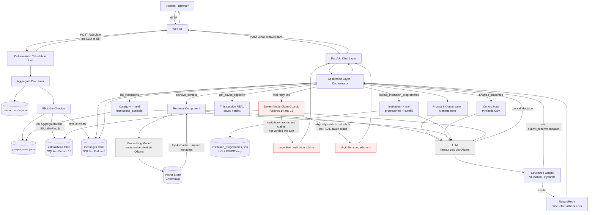

# PathwayGH Advisor — System Architecture

## Diagram

**Reading the diagram:** the calculation path (left) and the chat path
(right) are separate - `/calculate` never touches the LLM at all, and
chat never has tool access to `compute_aggregate`/`check_eligibility`
directly (see Failure 6, and the "Tool Execution Layer" section below).
They share state through two SQLite tables: `messages` (the human-readable
text summary chat can read) and `calculations` (the real structured
result, added for Failure 15, that `get_saved_eligibility` and the
eligibility-contradiction guard check against instead of trusting chat's
own recollection of the text). The red boxes are the deterministic guards
added after Failures 14 and 15 - they run on every reply regardless of
which tools the model chose to call, because both failures involved the
model skipping real tools and answering from (incorrect) memory instead.

## Component Walkthrough (request trace)

**The deterministic calculation path (`/calculate`, no LLM involved at all):**

1. **User → Web UI → `/calculate`.** Student submits grades through the
   "Enter My Grades" form - English, Core Mathematics, BOTH Integrated
   Science and Social Studies (see Failure 16 for why both; WAEC requires
   both of every candidate regardless of track), and 3-4 electives.
2. **Aggregate Calculator** (`app/tools/aggregate_calculator.py`) sums
   English + Core Maths + whichever of Integrated Science/Social Studies
   scores better, plus the best 3 of the submitted electives, against
   `grading_scale.json`. Checks the mandatory credit gate on exactly the
   three subjects actually counted.
3. **Eligibility Checker** (`app/tools/eligibility_checker.py`) takes the
   computed aggregate, electives, and (since Failure 16) the student's
   actual Integrated Science/Social Studies grades, and checks each
   category in `programmes.json`: aggregate band, elective requirements,
   AND (where a category names one specifically) the right core subject
   at credit level - independent of which one was better for the
   student's own aggregate.
4. **Two places the real result goes**, both from the same `/calculate`
   call: a human-readable text summary into the `messages` table (so chat
   can see it happened), and the full structured `AggregateResult`/
   `EligibilityResult` into a separate `calculations` table (added for
   Failure 15) - the second one is what makes "the real answer" checkable
   later, rather than relying on chat rereading its own text correctly.

**The chat path (`/chat`, `/chat/stream`):**

5. **FastAPI chat layer → Orchestrator.** Loads session history, appends
   the new message, and runs the tool-decision loop (`_resolve_tools`)
   until the model either calls `submit_recommendation` or answers with
   no more tool calls.
6. **Prompt & conversation management.** The system prompt instructs the
   model: never invent a cutoff, institution, or programme name; always
   call the matching real tool instead of relying on memory of an earlier
   message in this conversation (rules 5b-5e exist specifically because
   this was tried with weaker wording first and failed live - see
   Failures 7, 12, 13, 15).
7. **LLM (local, via Ollama)** decides, via tool-calling, which of the six
   chat-facing tools (below) it needs, if any, before it can answer.
8. **Tool execution layer** - six tools available to chat
   (`app/llm/tool_schemas.py::ALL_TOOLS`), all deterministic except the
   LLM's own decision of *when* to call them:
   - **`retrieve_context`** - embeds the query, searches ChromaDB for the
     WASSCE admission guide, returns chunks with source URLs attached.
   - **`analyze_outcomes`** - cohort statistics over the synthetic
     demonstration dataset; `data_source` always carries the "this is
     synthetic, not real" caveat from code (Failure 9).
   - **`list_institutions`** - a category's real `institutions_example`,
     copied verbatim from `programmes.json` (Failure 12).
   - **`lookup_institution_programmes`** - an institution's real
     programmes and cutoffs from `institution_programmes.json` (currently
     University of Ghana and KNUST only; `has_data_for_institution: False`
     for everything else) (Failure 13).
   - **`get_saved_eligibility`** - this session's REAL saved eligibility
     verdict for one category, from the `calculations` table (Failure 15).
   - **`submit_recommendation`** - the structured-output mechanism
     (Question 5); the model's final qualitative answer must go through
     this, validated against the `Recommendation` schema.

   **Deliberately NOT available to chat:** `compute_aggregate` and
   `check_eligibility` - see Failure 6. Extracting six grade fields from
   free text via agentic tool-calling failed in four different ways
   across two models; the task was moved entirely to the deterministic
   `/calculate` form instead of keeping that as a chat tool.
9. **Structured output validation.** `submit_recommendation`'s payload is
   forced into a Pydantic schema. A failed validation triggers one repair
   attempt; a second failure returns a deterministic fallback.
10. **Deterministic claim guards** (`app/tools/institution_claim_guard.py`,
    `app/tools/eligibility_claim_guard.py`) run on the model's FINAL reply
    text, regardless of which tools it called this turn:
    - Flags any institution named alongside degree-sounding language that
      wasn't actually verified via a real `lookup_institution_programmes`
      call this turn (`unverified_institution_claims`, Failure 14).
    - Flags any category named alongside an eligibility verdict
      ("eligible"/"not eligible") that CONTRADICTS the real saved result
      in the `calculations` table (`eligibility_contradictions`, Failure
      15) - this one has absolute ground truth to compare against, so it
      flags a definite wrong answer, not merely "unverified".
    These exist because a live 8B local model was observed skipping real
    tools entirely across whole structured answers, not just embellishing
    correct results - a prompt rule alone was proven, live, not to be
    enough (see Failure 14's writeup for the full reasoning on why this
    is a different class of fix from everything before it).
11. **Session state (SQLite).** Two tables, both keyed by session ID:
    `messages` (conversation history) and `calculations` (the real
    structured result of the last `/calculate` call, added for Failure
    15). The LLM itself is stateless between calls; every call receives
    the full relevant context explicitly.

## Where Application State and Memory Reside

- **Conversation memory**: `messages` table, SQLite, keyed by session ID.
  Not inside the LLM, not inside the vector store.
- **The real, structured calculation result**: `calculations` table,
  SQLite, keyed by session ID - separate from `messages` specifically
  because the human-readable text in `messages` is something a model can
  (and did, live) misread; `get_saved_eligibility` and the
  eligibility-contradiction guard read from `calculations`, never from
  `messages`. Added for Failure 15.
- **Domain knowledge**: static JSON - `grading_scale.json` and
  `programmes.json` for category-level facts that must be exact,
  `institution_programmes.json` for the (currently 2-institution)
  per-programme cutoff data, and the vector store for facts that need
  retrieval-with-citation.
- **No implicit state**: every LLM call is given the orchestrator-assembled
  context explicitly; nothing is "remembered" by the model itself.

## Error-Handling Boundaries

Each external-facing call (LLM call, retrieval call, tool call) is wrapped
independently so one failure doesn't take down the whole turn:
- **LLM unavailable / Ollama down** → orchestrator returns a clear
  "advisor temporarily unavailable" message, not a silent hang.
- **Retrieval failure / empty vector store result** → the system says it
  couldn't find supporting information, rather than letting the LLM answer
  from unguided pretraining knowledge on a factual question.
- **Tool failure** (bad input grade format, unknown category/institution
  name, no saved calculation yet) → caught as a `ValueError`, fed back to
  the model as a tool error rather than raised and left unhandled.
- **Malformed structured output** → one repair retry, then deterministic
  fallback (see above).
- **The model answers without calling a tool at all, or contradicts a
  tool result it did get** → NOT caught at the tool-call layer, because
  there's no failed call to catch - this is exactly why the deterministic
  claim guards (step 10 above) exist as a separate, later boundary that
  inspects the final reply text itself rather than any individual tool
  call's success or failure.

## Justification of Key Decisions

- **Local model via Ollama, not a hosted API**: no student data (grades,
  stated interests) leaves the machine/server it runs on, which matters for a
  system handling minors' academic data, and avoids per-request API cost for a
  course assignment with a real evaluation workload.
- **Model choice history — `qwen2.5:1.5b` initially, switched to
  `llama3.1:8b`**: the build started on `qwen2.5:1.5b` over `llama3.2:1b`,
  reasoning that Qwen2.5-Instruct models are tuned for structured-output
  reliability at small scale, and accepting as a deliberate trade-off that a
  1.5B model would produce malformed structured output more often than a
  larger model. That trade-off was treated as a real case to evaluate, not
  hidden — and live testing confirmed it, surfacing three distinct failure
  modes documented in detail in `docs/evaluation.md`: the model misreporting
  a real tool's result as fabricated category names (Failure 3), getting
  stuck re-asking for information it already had instead of acting on it
  (Failure 4), and — the most serious — writing fake tool-call-shaped JSON
  directly into its reply instead of triggering Ollama's real tool-calling
  mechanism at all (Failure 5). Based on that evidence, the default model
  was switched to `llama3.1:8b`, which has Ollama's most mature,
  officially-templated native tool-calling support of any locally-runnable
  model considered. This is expected to substantially reduce Failures 3 and
  5 specifically, though it has not been re-verified against live Ollama
  from the environment this project was built in (see evaluation.md's
  "what this does and doesn't fix" note on Failure 5) - the person running
  this should re-run `scripts/run_eval.py`'s manual cases after switching
  models and record what actually changes, rather than assuming the switch
  alone is sufficient. The validation/repair path and the fake-tool-call
  extractor in `app/llm/ollama_client.py` stay in the architecture
  regardless of model choice, precisely because a model swap is a
  probabilistic improvement, not a guarantee.
- **`nomic-embed-text` for embeddings**: lightweight (~274MB) relative to
  larger embedding models, runs alongside the chat model without resource
  contention, and gives materially better retrieval quality than the smallest
  alternatives (e.g. `all-minilm`) for a corpus this size.
- **Deterministic tools for arithmetic/lookup (Q: why not let the LLM do it?)**:
  aggregate calculation and cutoff lookups are exact, auditable operations.
  An LLM asked to "add six numbers and compare to a threshold" will
  occasionally be wrong in ways that are hard to catch; a Python function
  wrapping the same JSON table is both correct and independently testable.
- **Retrieval over putting the whole corpus in the prompt**: the source corpus
  will grow (more programmes, more institutions) past what fits usefully in
  a context window, and retrieval keeps each answer grounded in the specific
  passage relevant to the question rather than diluting the model's attention
  across unrelated sections — this is also the direct answer to the brief's
  required "why is retrieval preferable" question (Q7).
- **SQLite over an in-memory dict for session state**: survives a server
  restart during the 30-day build/demo period, and makes "reset session" a
  real, auditable operation rather than a guess about whether memory was
  actually cleared.
- **Two SQLite tables (`messages`, `calculations`), not one.** Storing
  only the human-readable text summary (as the original design did) meant
  the only way chat could answer a later question about eligibility was
  to reread and correctly interpret its own earlier prose - which a live
  8B model failed to do (Failure 15: it told a student they WERE eligible
  for a category its own earlier text had marked ineligible). Persisting
  the actual structured result separately means a later question can be
  checked against ground truth instead of against a retelling of ground
  truth - the same reasoning that already applied to `calculation` in
  chat responses (Failure 3) extended to session storage itself.
- **Post-hoc deterministic claim guards (Failures 14, 15), not just more
  system-prompt instructions.** By Failure 12, the fix pattern for every
  observed failure had been "give the model a real tool + a prompt rule
  telling it to use that tool." That stopped being sufficient when a live
  run showed the model skipping a real, available tool entirely across a
  whole structured multi-paragraph answer, inventing institutions and
  programmes with total confidence, and only checking reality when
  directly challenged three turns later. No prompt wording closes that
  gap for a small local model with probabilistic instruction-following -
  so the architecture added a layer that runs AFTER the model's reply is
  finalized: scan the text itself for claims, check them against whatever
  ground truth is available (the institution/programme data for Failure
  14; the actual saved eligibility result for Failure 15), and surface a
  flag or correction independent of what the model wrote. This can't
  rewrite the model's sentence - no code should attempt to silently edit
  free-form natural language - but it can guarantee the student also sees
  the real answer alongside it. This is a deliberate shift from
  "constrain the model's behavior" to "verify the model's output," and is
  the direct architectural answer to Question 11's "discuss an observed
  failure and how it could be improved" for the two most serious failures
  found.
